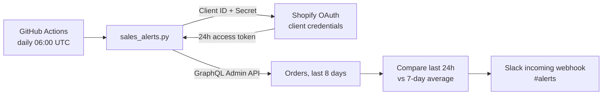

# Shopify Sales Alerts

A daily check that reads a Shopify store's orders, compares the last 24 hours to the store's normal day, and posts the result to Slack. Sales drops, sales spikes and high refund rates show up in Slack the same morning, so nobody has to open a dashboard to notice them.


Part of an e-commerce automation portfolio by **Riad Mrad** ([StoreOpsCo](https://storeopsco.com)).

---

## What a report looks like

```
Daily sales check: storeopsco-lab.myshopify.com
Status: SALES DROP
Last 24h: 0 orders, 0.00 USD
7-day daily average: 382.86 USD
Refunded (last 24h): 0.00 USD (0%)

🔴 Sales are 0% of a normal day.
```

| Status | When it fires |
|---|---|
| **SALES DROP** | Last 24h sales are below 60% of the 7-day daily average |
| **SALES SPIKE** | Last 24h sales are above 150% of the average (check stock and ad spend) |
| **Refund warning** | Refunds are more than 10% of the last 24h sales |
| **Normal** | None of the above |

Thresholds are constants at the top of `sales_alerts.py`.

## How it works



1. **Authenticate.** The script exchanges the app's Client ID and Secret for a short-lived Admin API token using Shopify's client credentials grant. No long-lived token is stored anywhere.
2. **Fetch.** It pulls orders processed in the last 8 days through the GraphQL Admin API, following pagination 100 orders at a time.
3. **Analyze.** The last 24 hours are compared to the average of the 7 days before. Orders are grouped by `processedAt`, the same sale date Shopify's own reports use.
4. **Report.** A formatted summary goes to Slack through an incoming webhook.

## Reliability

- **Failures alert too.** Any error (expired credentials, API change, missing permission) is caught and posted to Slack as *Sales check failed* with the reason, and the run exits non-zero so GitHub marks it red. A silent failure is the worst outcome for a monitoring job.
- **No secrets in code.** Credentials live in GitHub Actions secrets (or a local `.env` that `.gitignore` excludes).
- **No dependencies.** Python standard library only, so there is nothing to install or keep patched.
- **Tested logic.** Unit tests cover drop, spike, refund, no-history and date-window cases, and run on every push.

## Setup

### 1. Shopify app
1. In the [Shopify Dev Dashboard](https://dev.shopify.com/dashboard), create an app.
2. Add the Admin API scopes `read_orders` and `read_products`.
3. Set **Custom distribution** for your store and install the app.
4. Make sure the app has protected customer data access (needed to read the `Order` object).
5. Copy the **Client ID** and **Client Secret**.

### 2. Slack webhook
Create a Slack app with the `incoming-webhook` scope, install it to a channel such as `#alerts`, and copy the webhook URL.

### 3. Run locally
```bash
cp .env.example .env      # Windows: Copy-Item .env.example .env
# fill in the four values in .env
python sales_alerts.py
```

### 4. Run daily on GitHub
Add four repository secrets under **Settings → Secrets and variables → Actions**:

| Secret | Value |
|---|---|
| `SHOPIFY_STORE` | `your-store.myshopify.com` |
| `SHOPIFY_CLIENT_ID` | App Client ID |
| `SHOPIFY_CLIENT_SECRET` | App Client Secret |
| `SLACK_WEBHOOK_URL` | Slack webhook URL |

The workflow in `.github/workflows/daily.yml` runs every day at 06:00 UTC. Use **Actions → Daily sales check → Run workflow** to run it on demand.

## Test data for a development store

`seed_orders.py` fills a **development store** with backdated, paid test orders so the comparison has a realistic history. It needs the extra scope `write_orders`.

```bash
python seed_orders.py --dry-run          # preview the plan
python seed_orders.py --days 10 --per-day 3
```

Orders are tagged `seed-test-order`, and the script paces itself to stay under Shopify's dev-store order creation limit.

## Tests

```bash
python -m unittest discover -s tests -v
```

## Project structure

```
sales_alerts.py              # the daily check
seed_orders.py               # backdated test orders for dev stores
tests/test_sales_alerts.py   # unit tests for the alert logic
.github/workflows/daily.yml  # daily schedule
.github/workflows/tests.yml  # tests on every push
.env.example                 # settings template
```

## Possible next steps

- Compare against the same weekday last week to handle weekly seasonality
- Track ad spend alongside sales (ROAS alerts)
- Send a weekly summary in addition to the daily check
